# 创意工作台

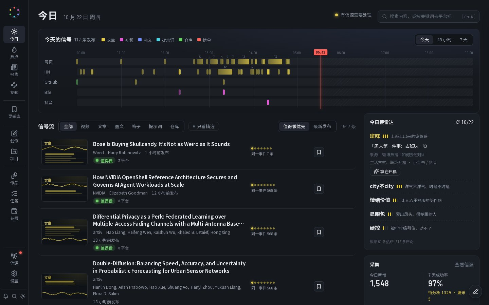

本地优先、单用户的 AI 内容创作工作台。从信源采集开始，把热点判断、灵感收集、成稿、多平台改写、视频制作和发布复盘放进一条连续的流程里。

**信源采集 → 今日 / 热点 / 专题 → 灵感库 → 项目（选题 → 文稿 → 产出）→ 作品 → 发布与数据回收**

数据保存在本机 PostgreSQL，模型通过你自己配置的服务调用（DeepSeek、通义千问、OpenAI 兼容中转站等），不需要登录。

## 功能一览

| 分区 | 做什么 |
| --- | --- |
| 今日 | 当天信号时间线（按平台、北京时间）、按「值得做」排序的信号流、今日梗雷达、采集状态 |
| 热点 / 专题 | 多平台热榜、跨平台共振，同一事件自动归成专题并跟踪热度变化 |
| 报告 | 日报、周刊、月刊；月刊带「创作人格」分享图 |
| 灵感库 | 链接 / 图片 / 视频 / 提示词 / 随笔收集，情绪板、图谱视图、爆款拆解 |
| 创作 · 项目 | 三步：选题与创意 → 文稿 → 产出；AI 研究员给方向、写手与审校成稿、版本与溯源 |
| 作品 | 所有产出按项目归档，复制、下载、发布排期、发布后自动回抓数据 |
| 任务 / 花费 | 流程运行、生成任务、采集、分析统一一张任务表；按用途 / 模型 / 项目统计花费 |
| 信源 / 设置 | RSS、平台订阅、追踪词与健康度；模型路由、生成服务、飞书、公众号、备份等 |

## 从发现到创作

### 今日、热点与专题

今日页把当天采集到的内容画在一条时间线上，信号流按「值得做」排序，右侧是从热榜标题和热门评论里提炼的今日梗。热点页汇总百度、B 站、抖音、豆瓣、Hacker News 等榜单；同一件事在多个平台出现时会归到一个专题里。

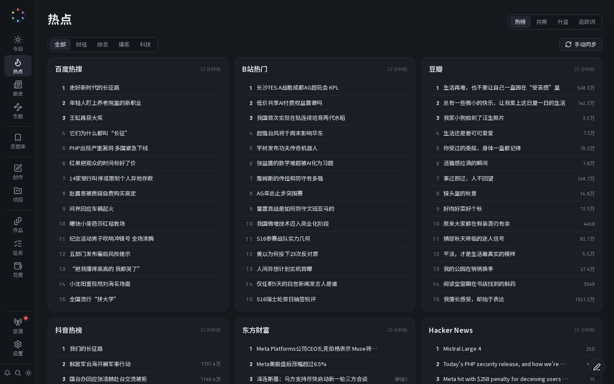

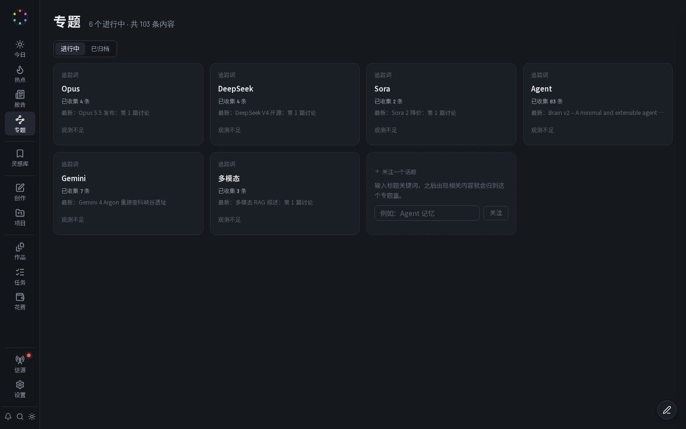

### 灵感库

贴链接（B 站、YouTube、GitHub、小红书、任意网页）或上传文件就能收进来，按授权和类型筛选，组成情绪板。图谱视图展示条目、专题、项目之间的关联。贴一条爆款链接可以做「爆款拆解」：钩子、节奏、情绪点、评论高频词和可复用的结构，拆完可以「照这个结构写」自己的主题。

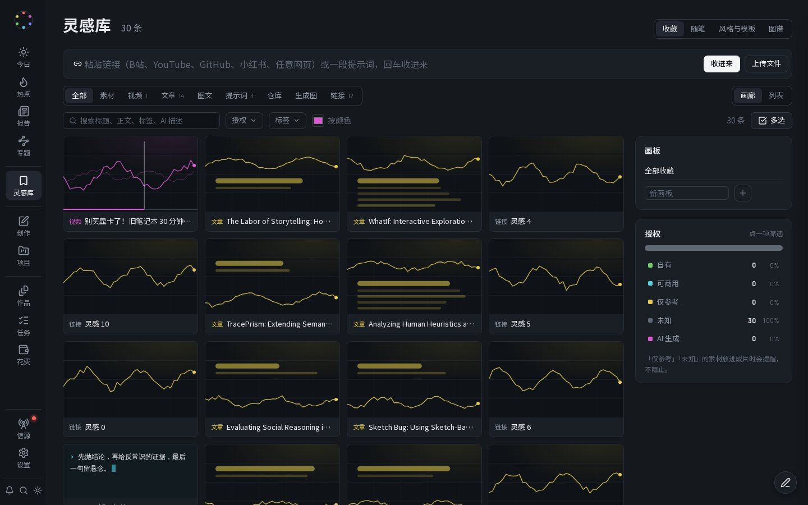

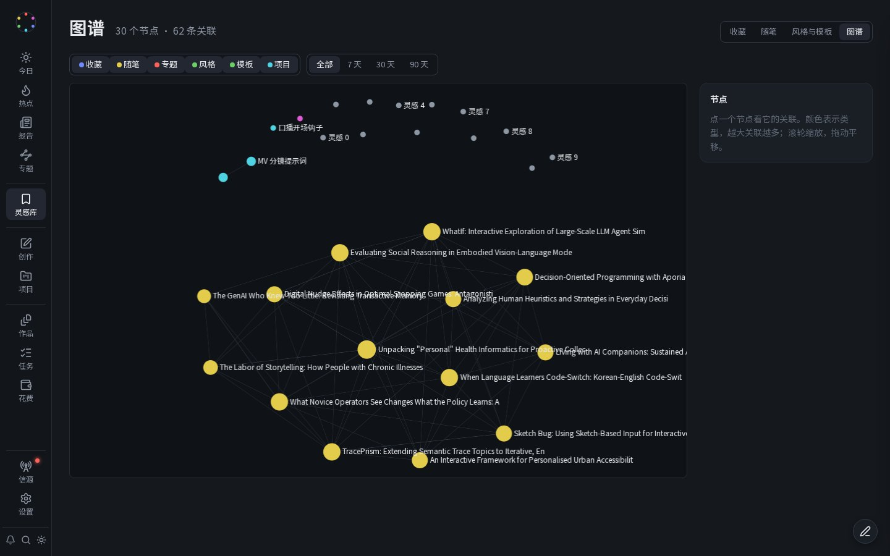

### 项目：选题与创意

从灵感库、今日或手动输入挑来源（1 个主来源 + 最多 9 个参考），写主题、受众、语气和创作思路。「AI 给出方向」会让研究员调用检索工具后给出几张方向卡，点一张就填进设定。

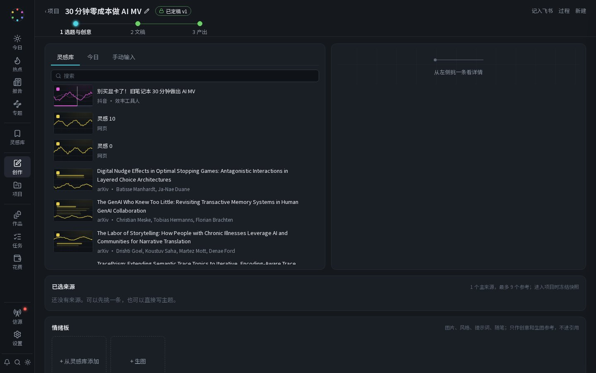

### 项目：文稿

富文本纸面编辑器，左侧大纲可拖动整节，右侧 AI 助手按选区改写。「AI 写全文」走写手 → 审校 → 写手修改的流程，接受后存成新版本；任意版本可以对比、回退，每一段都能溯源到用到的来源。支持暗色 / 亮色两套主题。

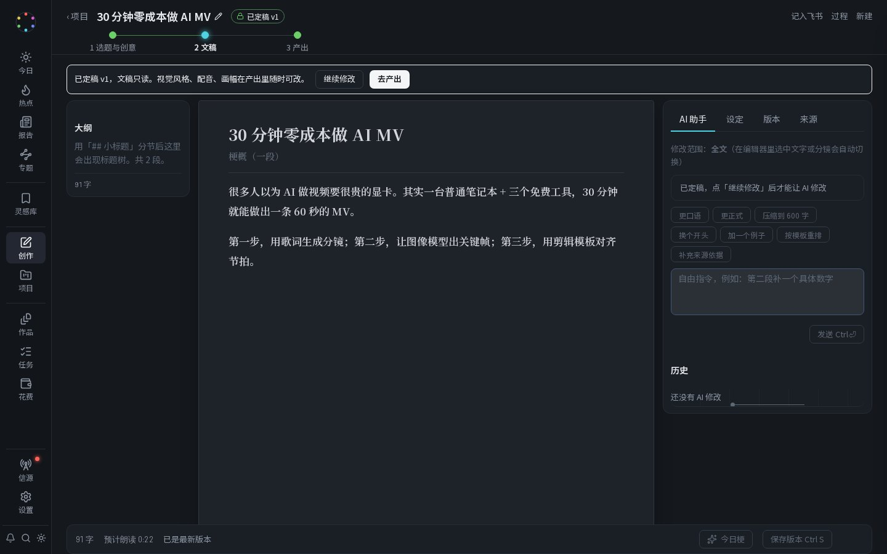

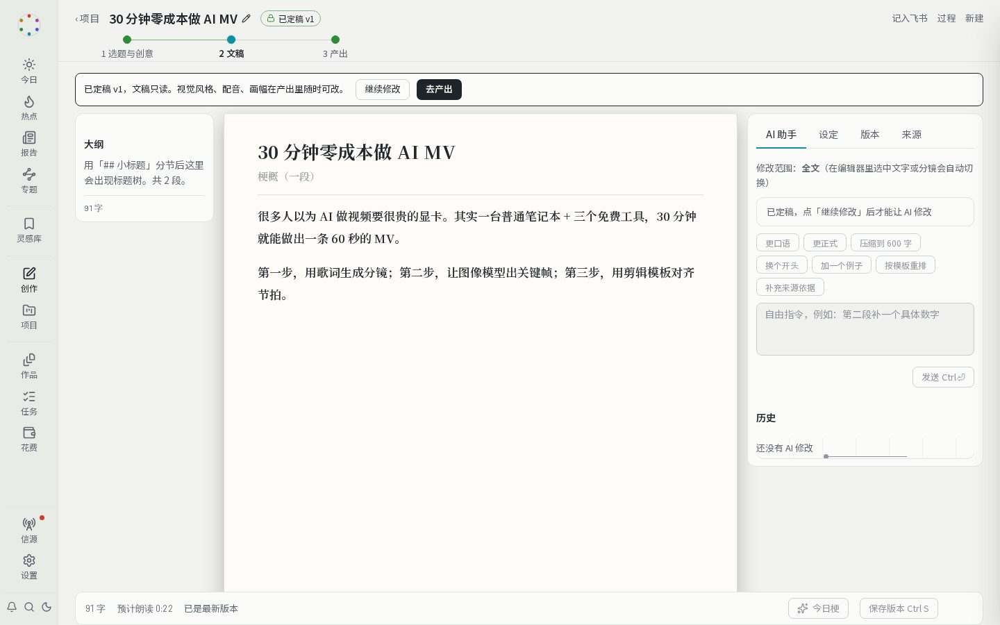

### 项目：产出

定稿后一键改写成小红书、抖音、B 站、知乎、公众号版本，每个平台按自己的写法和字数规则生成，并排显示原生样式预览；也可以继续做讲解视频、音乐 MV 或给外部 agent 的视频提示词包。


### 作品、任务与搜索

有正文的平台版本和完成的成片自动进作品库，可以复制、下载、排期发布，填发布链接后按时回抓播放和互动数据。任务页汇总所有后台运行，失败的给出原因和处理建议。全局搜索（Ctrl+K 或 `/`）同时查库内内容，也能按关键词去平台现抓。

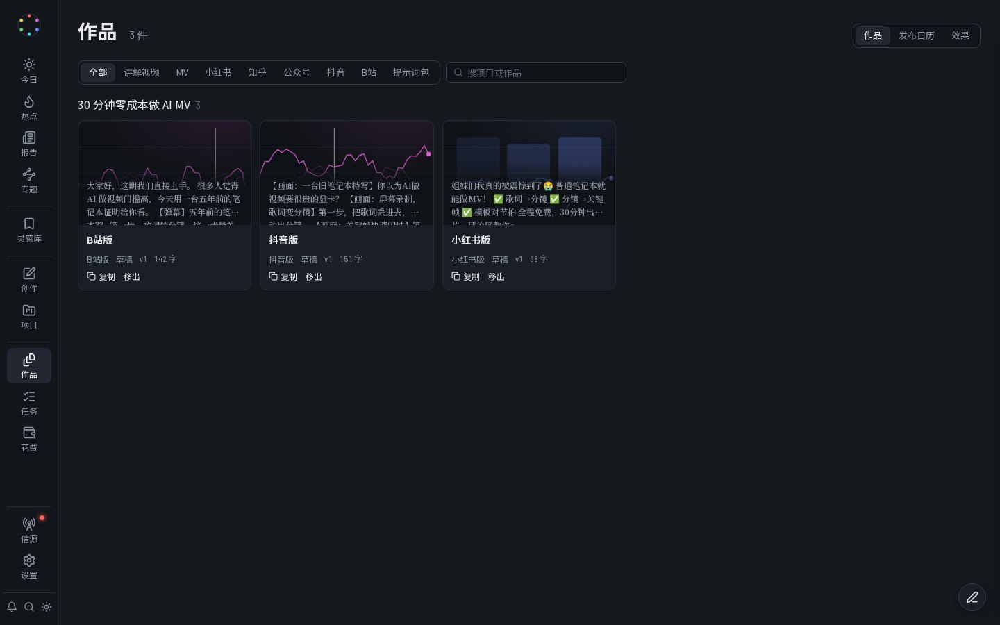

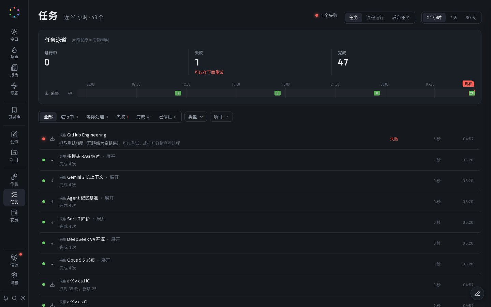

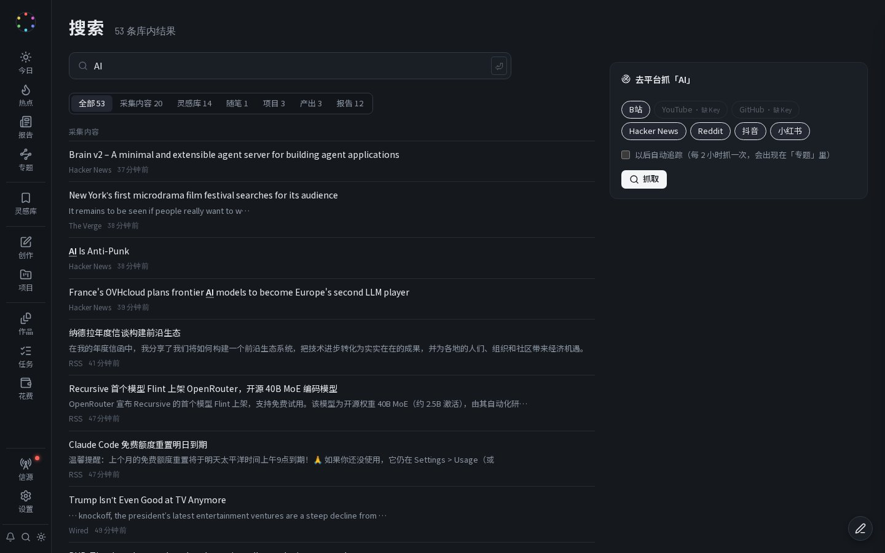

### 信源与报告

信源页显示每个源的同步状态、成功率和处理建议。月刊统计一个月的创作，给出「创作人格」并导出分享图。

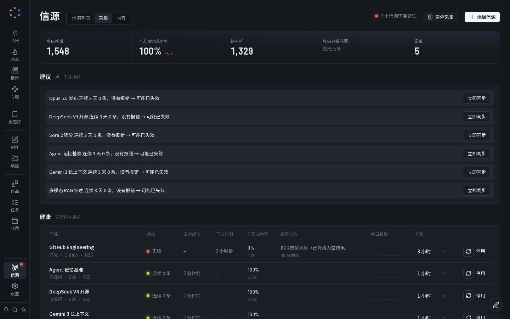

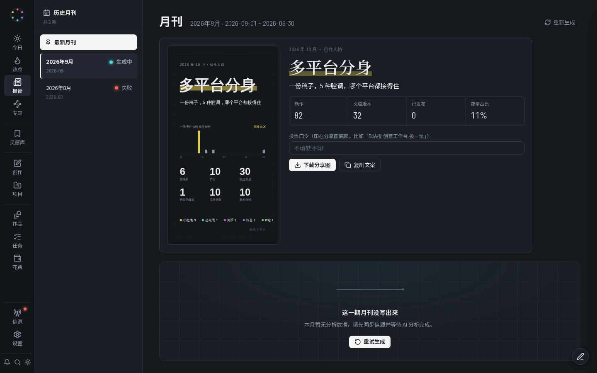

### 模型配置

同一路由组里的模型按顺序调用，前一个失败或限流就自动换下一个。表单可以「从接口拉取」模型列表，支持 A/B 测评、用量统计和测评历史。

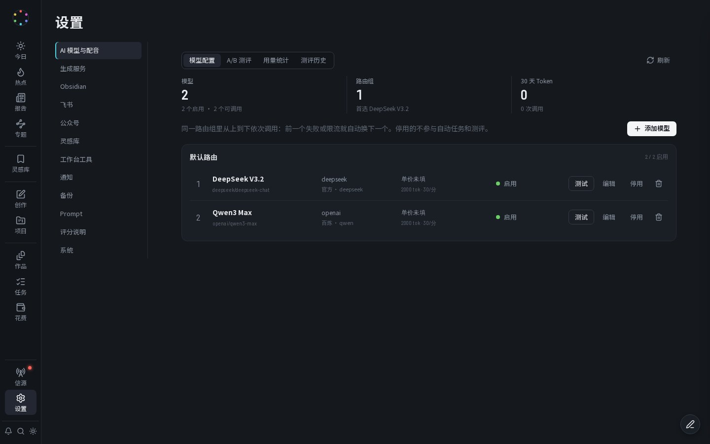

## Windows 快速启动

预装 **Node.js 20+** 和 **uv**，确认二者可在终端调用。进入项目目录，双击 `start.cmd`。

首次启动会安装 Python 3.12、前后端及 Remotion 依赖，下载 PostgreSQL 16 Windows 程序并在 `backend/data/` 初始化独立工作库，生成本机 `backend/.env`，构建前端并打开工作台。之后启动复用环境与数据库；已有 `.env` 会保留，自己的 PostgreSQL 可通过 `DATABASE_URL` 接入。

| 服务 | 默认地址 |
| --- | --- |
| 工作台 | `http://127.0.0.1:3000` |
| 后端 API | `http://127.0.0.1:8102` |
| API 文档 | `http://127.0.0.1:8102/docs` |

端口被占用时启动器会换到后面的空闲端口，实际地址显示在启动窗口。

开发模式：

```powershell
powershell -NoProfile -ExecutionPolicy Bypass -File .\start-local.ps1 -Development -OpenBrowser
```

后台运行与开机自启：启动后托盘出现工作台图标（绿：运行，黄：已暂停，红：有信源需要处理，灰：后台未运行），菜单可打开工作台、记一笔、暂停 / 恢复采集；任务完成、报告生成等以 Windows 系统通知弹出。关闭浏览器不影响定时采集。

```powershell
powershell -NoProfile -ExecutionPolicy Bypass -File .\start-local.ps1 -RegisterAutostart   # 注册开机自启
powershell -NoProfile -ExecutionPolicy Bypass -File .\start-local.ps1 -UnregisterAutostart # 取消
```

拉取新代码后请重启前后端，否则页面仍是旧构建。

## 首次配置

1. **模型**：设置 → AI 模型与配置 → 添加模型，填服务地址、API Key 和模型名（可「从接口拉取」）。用中转站时，模型名要填中转站分组里实际可用的名字。没有模型时，成稿可用模板生成结构，但 AI 写稿、日报、内容分析都不可用。
2. **信源**：信源页添加 RSS、平台订阅或追踪词；抖音、小红书通过本机浏览器登录态采集。
3. **可选**：生成服务（生图 / 生视频，OpenAI 兼容接口）、飞书多维表格同步、公众号草稿箱直推、每周自动备份，都在设置里。

| 环节 | 实现 |
| --- | --- |
| 研究、成稿、审校、平台改写 | 可配置模型路由（litellm），流程引擎带关卡与重跑对比 |
| 生图 / 生视频 | OpenAI 兼容图像与视频接口 |
| 讲解配音 | 通义千问 TTS（需 DashScope Key） |
| 动画与合成 | DeepSeek Harness / Claude Code / Codex、React、Remotion、FFmpeg |
| 数据与界面 | PostgreSQL、FastAPI、Next.js、Ant Design |

完整视频制作还需要 **FFmpeg / ffprobe** 和至少一个外部执行者（`dsh`、`claude` 或 `codex`）。

## 手动启动

适用于已有 PostgreSQL 或其他操作系统。创建工作库，把 `backend/.env.example` 复制为 `backend/.env` 并填写 `DATABASE_URL`。

```sh
# 后端
cd backend
uv sync --frozen --python 3.12
uv run python -m uvicorn app.main:app --host 127.0.0.1 --port 8102

# 前端（另一个终端）
cd frontend
npm ci
npm run dev -- --hostname 127.0.0.1 --port 3000
```

动画依赖：`cd backend/media_runtime && npm ci`。浏览器采集依赖：在 `backend/` 下执行 `uv run playwright install chromium`。数据库迁移在后端启动时自动执行。

## 源码结构

```text
backend/app/               API、服务、流程引擎、模型与任务
backend/app/services/flows/  研究员、写手、审校、平台编辑等角色
backend/alembic/           数据库迁移
backend/media_runtime/     Remotion 模板与组件
backend/tests/             后端测试
frontend/src/app/          页面（今日、热点、灵感库、项目、作品……）
frontend/src/design/       设计系统与业务组件
docs/plan/                 设计文档与开发进度
docs/assets/               README 截图
start.cmd / start-local.ps1  Windows 启动入口与环境准备
```

## 验证

```sh
cd frontend
npx tsc --noEmit && npx vitest run && npx eslint --quiet .
cd ../backend
uv run ruff check . && uv run python -m pytest -q
```

集成测试的 `DATABASE_URL` 指向独立的 `creative_workbench_test` 数据库。

## 来源与许可

基于 [fxbin/TopicEye](https://github.com/fxbin/TopicEye) 二次开发，沿用 Apache-2.0 许可，版权归原作者 fxbin。许可全文见 [LICENSE](LICENSE)。
